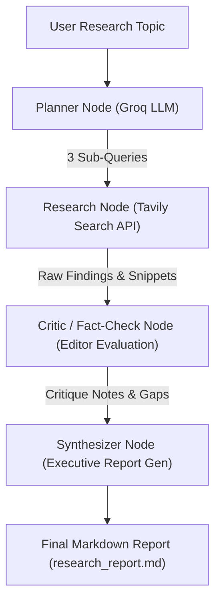

# Multi-Agent Deep Research & Synthesis System 🤖🔍

A production-grade, multi-agent orchestration framework built with **LangGraph**, **Groq**, and **Tavily**. This system autonomously deconstructs complex research topics, executes parallel web searches, evaluates findings through a rigorous editorial critic node, and synthesizes executive-level Markdown research reports with full source citations.

---

### 📐 Architecture & Multi-Agent Flow



---

### 👥 Agent Role Breakdown

1. **Planner Agent:** 
   - Acts as the research director. Takes the user's broad topic and deconstructs it into 3 specific, highly targeted sub-queries optimized for web retrieval.
2. **Research Agent:** 
   - Executes parallel searches via the Tavily Search API for each sub-query, gathering raw web snippets, page titles, and source URLs.
3. **Critic / Fact-Check Agent:** 
   - Acts as a rigorous managing editor. Reviews collected snippets for technical gaps, missing enterprise angles, or contradictions, generating structured critique notes.
4. **Synthesizer Agent:** 
   - Acts as a principal technical writer. Compiles raw findings and editor critique notes into a structured, executive-level Markdown report complete with metric tables, technical details, and inline source citations.

---

### 🛠️ Tech Stack & Architecture Design
- **Orchestration:** LangGraph (`StateGraph` pipeline with explicit state passing)
- **LLM Engine:** GroqCloud (`openai/gpt-oss-20b` for ultra-fast, high-throughput token generation at zero cost)
- **Search API:** Tavily Python Client (Optimized for LLM agent research extraction)
- **Environment & State:** Pydantic schema validation (`ResearchState` TypedDict) and `python-dotenv`

---

### ⚠️ Architectural Limitations & Production Considerations

1. **Information Completeness & API Rate Limits:**
   - Tavily result caps and search window limitations mean highly niche or hyper-recent proprietary data may require specialized internal vector search (RAG) rather than public web searches.
2. **Deterministic vs. Generative Synthesis:**
   - While the graph routing and state transitions are strictly deterministic, the content generation relies on probabilistic LLM reasoning. Production deployments must pair this with human-in-the-loop review before publishing sensitive reports.

---

### 🚀 Quickstart & Local Run

1. **Clone the repository:**
   ```bash
   git clone https://github.com/drazaH21/02-multi-agent-deep-research.git
   cd 02-multi-agent-deep-research
   ```

2. **Set up virtual environment:**
   ```bash
   python -m venv venv
   source venv/Scripts/Activate.ps1  # On Windows PowerShell
   ```

3. **Install dependencies:**
   ```pip install -r requirements.txt```

4. **Configure your `.env` file:**
   Create a `.env` file in the root directory and add your API keys:
   ```env
   GROQ_API_KEY=your_groq_api_key_here
   TAVILY_API_KEY=your_tavily_api_key_here
   ```

5. **Run the research test suite:**
   ```bash
   python tests/test_research.py
   ```
   *The generated executive research report will automatically save as `research_report.md`.*